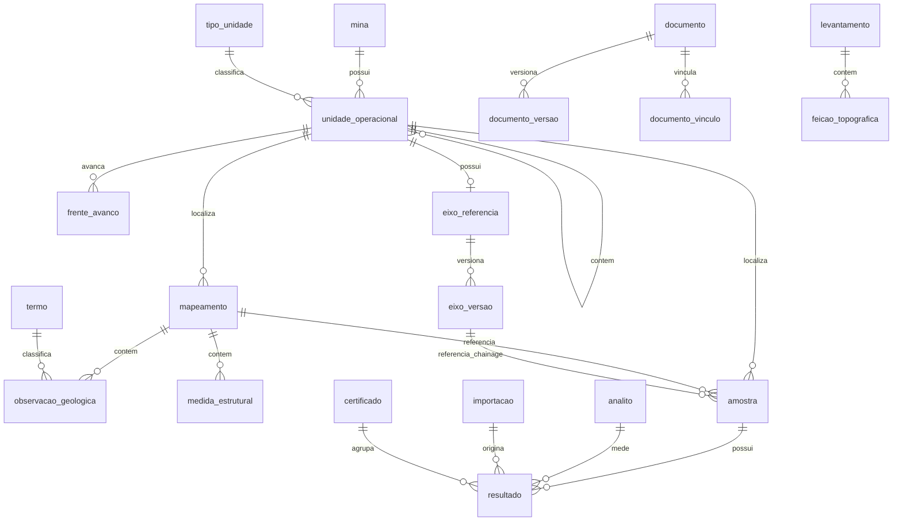

# BANCO DE DADOS — Modelo inicial

> Estado: modelo lógico da Etapa 1, **adaptado ao SQLite em 2026-11-25** (DT-016/DT-017).
> **Tabelas implementadas (migração `0001_nucleo`, Etapa 2):** `usuario`, `papel`, `permissao`, `papel_permissao`, `usuario_papel`, `sessao`, `auditoria`, `arquivo`, `parametro_sistema`. As demais ainda são projeto.

## 0. Adaptação ao SQLite (aplicativo local)

| Projeto original (PostgreSQL/PostGIS) | Implementação local (SQLite) |
|---|---|
| `geometry(PointZ/LineStringZ/…, srid)` | `geom` BLOB com WKB 2D/3D + `srid` + `dimensao`; índice R*Tree 3D |
| `ltree` (caminho da árvore) | coluna texto `caminho` materializada (`/id1/id2/…`) mantida pelo serviço, com índice |
| `JSONB` | `JSON` (texto validado; funções `json_*` do SQLite) |
| `citext` (login) | `COLLATE NOCASE` |
| `timestamptz` | `DateTime(timezone=True)` gravado sempre em UTC |
| `uuid` | `Uuid` do SQLAlchemy (32 caracteres hexadecimais) |
| auditoria por trigger com `SET LOCAL` | eventos do ORM + triggers de imutabilidade (DT-019) |
| `spatial_ref_sys` | base EPSG do PROJ (pyproj) |
| `num_nonnulls(...) = 1` | `CHECK ((a IS NOT NULL) + (b IS NOT NULL) + … = 1)` |
| `SELECT … FOR UPDATE` (gerar código) | transação `BEGIN IMMEDIATE` (o SQLite serializa escritas) |

> As tabelas serão criadas progressivamente, por migrações Alembic, na etapa de cada módulo.
> O modelo completo é apresentado agora para garantir que as primeiras tabelas não bloqueiem as seguintes, especialmente as espaciais.

## 1. Convenções

- PostgreSQL 16 + PostGIS 3; extensões `postgis`, `ltree`, `pgcrypto`, `citext`.
- Nomes em português, `snake_case`, singular.
- PK `id uuid` em todas as tabelas de domínio (DT-007).
- Colunas padrão de domínio: `criado_em timestamptz`, `criado_por uuid → usuario`, `atualizado_em`, `atualizado_por`, `versao int` (concorrência otimista), `ativo bool` quando houver inativação.
- Datas/horas em `timestamptz` (UTC no banco, exibição no fuso da mina).
- Geometrias sempre com SRID explícito = `mina.srid_trabalho`; Z em metros.
- Exclusão física proibida para registros com vínculos: `ON DELETE RESTRICT` como padrão; inativação lógica.
- `CHECK` para faixas de valores (mergulho, azimute, chainage ≥ 0 etc.).
- Auditoria por trigger em todas as tabelas de domínio (seção 9).

## 2. Núcleo — usuários e permissões (Etapa 2) **[IMPLEMENTADO]**

| Tabela | Colunas principais | Restrições |
|--------|--------------------|-----------|
| `usuario` | id, nome, email `citext`, login, senha_hash, ativo, ultimo_acesso | UNIQUE(login), UNIQUE(email) |
| `papel` | id, codigo, nome | UNIQUE(codigo) |
| `permissao` | id, codigo (`modulo:acao`), descricao | UNIQUE(codigo) |
| `papel_permissao` | papel_id, permissao_id | PK composta |
| `usuario_papel` | usuario_id, papel_id | PK (usuario, papel). *Restrição por mina adiada até existir mais de uma mina.* |
| `sessao` | id, usuario_id, token_hash, criado_em, expira_em, revogado_em | UNIQUE(token_hash) (DT-018) |
| `parametro_sistema` | chave, valor | ex.: `instalacao_id` |

## 3. Estrutura operacional (Etapa 3)

| Tabela | Colunas principais | Restrições / observações |
|--------|--------------------|--------------------------|
| `mina` | id, codigo, nome, srid_trabalho, unidade_comprimento ('m'), fuso_horario, origem_local_x/y/z (opcional), observacoes | UNIQUE(codigo); FK srid → `spatial_ref_sys` |
| `tipo_unidade` | id, codigo, nome, icone, cor, possui_eixo bool, multinivel bool, e_frente bool, ordem | UNIQUE(codigo). Ex.: REGIAO, NIVEL, GALERIA, TRAVESSA, RAMPA, SUBDIVISAO, FRENTE, REALCE, CHAMINE |
| `regra_hierarquia` | tipo_pai_id, tipo_filho_id | PK composta — define quais tipos podem conter quais |
| `unidade_operacional` | id, mina_id, tipo_id, pai_id (nulo = raiz da mina), codigo, nome, caminho `ltree`, cota_referencia, status, descricao, ativo | UNIQUE(mina_id, codigo); `pai` da mesma mina (trigger); tipo do pai permitido por `regra_hierarquia` (trigger); `caminho` mantido por trigger; GiST em `caminho` |
| `unidade_nivel` | unidade_id, nivel_id | Para unidades multinível (rampa ↔ níveis). `nivel_id` deve ser do tipo NIVEL |
| `frente_avanco` | id, frente_id, data, chainage, origem_chainage ('manual','calculado'), eixo_versao_id, geom PointZ, avanco_m, responsavel_id, observacao | `frente_id` deve ser unidade com `e_frente` |

> **Por que árvore genérica?** Ver ANALISE_CRITICA A1. A hierarquia é configurável, impõe regras pelo banco e permite consultar a sub-árvore inteira com `caminho <@ 'MINA.N350.GAL01'`.

## 4. Dicionários configuráveis (Etapa 5)

| Tabela | Colunas | Observações |
|--------|---------|-------------|
| `dicionario` | id, codigo, nome, descricao, sistema bool | Ex.: LITOLOGIA, ALTERACAO, INTENSIDADE, TIPO_ESTRUTURA, MINERAL, ESTILO_MINERALIZACAO, TIPO_ATIVIDADE, TIPO_CONTATO |
| `termo` | id, dicionario_id, codigo, nome, descricao, cor, pai_id (hierarquia de termos, ex.: grupo litológico), ativo, ordem | UNIQUE(dicionario_id, codigo) |
| `definicao_atributo` | id, contexto (ex.: `observacao:ALTERACAO`), codigo, rotulo, tipo (texto/num/inteiro/data/termo/booleano), dicionario_id, obrigatorio, min, max, unidade | Campos customizados (DT-009) |

## 5. Mapeamento geológico (Etapa 5)

| Tabela | Colunas principais | Restrições |
|--------|--------------------|-----------|
| `mapeamento` | id, mina_id, unidade_id, data, geologo_id, tipo_atividade_termo_id, chainage_de, chainage_ate, origem_chainage, eixo_versao_id, geom PointZ, referencia_espacial (texto), descricao, observacoes, estado (`rascunho`/`submetido`/`aprovado`/`cancelado`), revisao int | estado aprovado → edição gera nova revisão |
| `mapeamento_revisao` | id, mapeamento_id, revisao, conteudo JSONB (instantâneo completo), revisado_por, revisado_em, motivo | UNIQUE(mapeamento_id, revisao) |
| `observacao_geologica` | id, mapeamento_id, categoria (`litologia`/`contato`/`alteracao`/`mineralizacao`/`mineralogia`/`outra`), termo_id, intensidade_termo_id, posicao_de, posicao_ate, posicao_referencia (`chainage`/`face_esquerda`/`face_direita`/`teto`/`frente`), percentual, descricao, atributos JSONB | termo deve pertencer ao dicionário da categoria |
| `medida_estrutural` | id, mapeamento_id, tipo_termo_id, classe (`planar`/`linear`), dip_dir, dip, trend, plunge, valor_digitado JSONB, convencao_entrada, norte_referencia (`magnetico`/`quadricula`/`verdadeiro`), declinacao_aplicada, plano_hospedeiro_id, geom PointZ, descricao | CHECK dip ∈ [0,90], dip_dir/trend ∈ [0,360), plunge ∈ [0,90]; planar exige dip_dir+dip; linear exige trend+plunge |

## 6. Arquivos, croquis, fotos, documentos (Etapas 6–7)

| Tabela | Colunas principais | Observações |
|--------|--------------------|-------------|
| `arquivo` **[IMPLEMENTADO]** | id, sha256, tamanho, mime, nome_original, chave, enviado_por, enviado_em | UNIQUE(sha256) — conteúdo deduplicado |
| `documento` | id, mina_id, categoria (`croqui`/`foto`/`relatorio`/`planilha`/`gis`/`topografia`/`campo`/`outro`), titulo, descricao, data_documento, autor_id, estado | entidade lógica com versões |
| `documento_versao` | id, documento_id, numero, arquivo_id, nome_original, motivo, criado_por, criado_em | UNIQUE(documento_id, numero); nunca apagada |
| `foto` | documento_id (PK/FK), legenda, identificador, data_captura, exif JSONB, geom PointZ, orientacao | especialização de documento |
| `documento_vinculo` | id, documento_id, unidade_id, mapeamento_id, amostra_id, medida_id, levantamento_id, observacao | **CHECK num_nonnulls(unidade_id, mapeamento_id, amostra_id, medida_id, levantamento_id) = 1** — FKs reais, sem vínculo polimórfico sem integridade |
| `derivado_arquivo` | arquivo_id, tipo (`miniatura`/`previa`), chave_armazenamento | regenerável |
| `sugestao_extraida` *(futuro)* | id, documento_versao_id, tipo, conteudo, confianca, estado (`nao_validada`/`aceita`/`rejeitada`), revisado_por | OCR/IA (RF-DOC-08) |

## 7. Amostragem e geoquímica (Etapas 8–9)

| Tabela | Colunas principais | Restrições |
|--------|--------------------|-----------|
| `tipo_amostra` | id, codigo, nome, geometria_esperada (`ponto`/`intervalo`/`ambos`) | — |
| `metodo_amostragem` | id, codigo, nome | — |
| `regra_codigo_amostra` | id, mina_id, nome, padrao_regex, prefixo, proximo_numero, digitos, ativo | geração atômica (`SELECT … FOR UPDATE`) |
| `campanha` | id, mina_id, codigo, nome, inicio, fim, objetivo | UNIQUE(mina_id, codigo) |
| `amostra` | id, mina_id, codigo, unidade_id, campanha_id, data_coleta, geologo_id, tipo_id, metodo_id, papel_controle (`normal`/`padrao`/`branco`/`dup_campo`/`dup_preparacao`/`dup_pulpa`), amostra_original_id, padrao_id, geom (PointZ ou LineStringZ), chainage_de, chainage_ate, origem_chainage, eixo_versao_id, afastamento_eixo_m, litologia_termo_id, alteracao_termo_id, mineralizacao_termo_id, estrutura_termo_id, mapeamento_id, massa_kg, descricao, observacoes, estado | UNIQUE(mina_id, codigo); duplicata exige amostra_original_id; padrão exige padrao_id; GiST(geom) |
| `padrao_referencia` | id, codigo, fornecedor, descricao | CRM |
| `padrao_valor_certificado` | padrao_id, analito_id, valor, desvio_padrao, unidade | — |
| `lote_envio` | id, mina_id, codigo, laboratorio_id, data_envio, responsavel_id, estado | — |
| `lote_envio_amostra` | lote_id, amostra_id | uma amostra pode ir em mais de um lote (reanálise) |
| `laboratorio` | id, codigo, nome | — |
| `metodo_analitico` | id, laboratorio_id (opcional), codigo, nome, tecnica (FRX, ICP-OES, AAS…), descricao | — |
| `unidade_medida` | codigo (`ppm`, `ppb`, `pct`, `g_t`…), fator_para_ppm | conversões explícitas |
| `analito` | id, codigo (`Cr`, `MgO`, `Fe2O3`…), nome, tipo (`elemento`/`oxido`/`mineral`/`parametro`), unidade_padrao | UNIQUE(codigo) — cadastro aberto |
| `importacao` | id, mina_id, tipo (`resultado`/`amostra`/`topografia`), documento_versao_id (arquivo original), mapeamento_colunas JSONB, relatorio_validacao JSONB, estado (`analisada`/`confirmada`/`cancelada`), importado_por, confirmado_em | arquivo original sempre vinculado |
| `certificado` | id, importacao_id, laboratorio_id, codigo (bateria/lote do laboratório), data_emissao | — |
| `resultado` | id, amostra_id, analito_id, metodo_id, certificado_id, importacao_id, valor_texto, valor_num, qualificador (`=`/`<`/`>`/`ND`/`IS`), limite_deteccao, unidade, data_analise, preferido bool, linha_origem int, ativo | UNIQUE parcial (amostra, analito, metodo, certificado) WHERE ativo; índice (analito_id, amostra_id); índice único parcial `preferido` por (amostra, analito) |

## 8. Espacial e topografia (Etapa 10 proposta)

| Tabela | Colunas principais | Observações |
|--------|--------------------|-------------|
| `spatial_ref_sys` (PostGIS) | + registros próprios SRID ≥ 900000 para grades locais | definição PROJ documentada |
| `transformacao_coordenadas` | id, srid_origem, srid_destino, pipeline_proj, precisao_estimada_m, aprovado_por, aprovado_em | toda transformação é registrada |
| `levantamento` | id, mina_id, codigo, descricao, data_levantamento, responsavel, importacao_id, documento_versao_id, srid_original, transformacao_id, extensao geometry(PolygonZ), estado, substitui_levantamento_id | levantamentos coexistem; nenhum é sobrescrito |
| `feicao_topografica` | id, levantamento_id, unidade_id (opcional), classe (`eixo`/`contorno`/`poligono`/`ponto`/`outro`), geom geometry(GeometryZ, srid), geom_original (quando transformado), dimensao_original (2/3), z_constante bool, atributos_originais JSONB, indice_origem | GiST(geom), índice(levantamento_id), índice(unidade_id) |
| `eixo_referencia` | id, unidade_id, descricao | um por unidade com eixo |
| `eixo_versao` | id, eixo_id, numero, geom LineStringZ, comprimento_3d_m, comprimento_2d_m, origem (`feicao`/`desenho`/`manual`), feicao_id, sentido_chainage, vigente bool, criado_por | índice único parcial de vigente por eixo |
| `camada_visualizacao` | id, codigo, nome, tipo_fonte, filtro JSONB, estilo JSONB, ordem, ativo | camadas extensíveis do 3D |

Colunas `eixo_versao_id` em `frente_avanco`, `mapeamento` e `amostra` serão FKs adicionadas na migração desta etapa (as colunas existem antes, nulas — sem retrabalho).

## 9. Auditoria (Etapa 2) **[IMPLEMENTADO — por ORM, DT-019]**

| Tabela | Colunas |
|--------|---------|
| `auditoria` | id bigserial, tabela, registro_id, operacao (`I`/`U`/`D`), antes JSONB, depois JSONB, usuario_id, ocorrido_em, transacao_id, origem (`api`/`importacao`/`direto`) |

- Trigger genérico `fn_auditoria()` em todas as tabelas de domínio.
- Particionamento por mês quando o volume justificar.
- Sem permissão de UPDATE/DELETE para o papel de banco da aplicação nessa tabela.

## 10. Diagrama de relacionamentos (núcleo)

## 11. Pontos em aberto do modelo

- Confirmar se haverá **mais de uma mina** no mesmo sistema (o modelo já suporta).
- Confirmar regras reais de código de amostra e de unidade.
- CRS confirmados: SIRGAS 2000 / UTM 23S (31983) e SAD69 / UTM 23S (29193). Proposta: CRS de trabalho = SIRGAS 2000 (a confirmar).
- `amostra.codigo`: regras BS-RP (mina), BMT-TS (testemunho), BE (antigas); forma canônica sem espaços (DADOS_REAIS.md §3).
- `termo`: acrescentar tabela `termo_sinonimo` (grafias encontradas na importação → termo).
- `resultado`: acrescentar `tipo_linha_laboratorio` (SMP/DUP/REP/STD) dos laudos SGS.
- Topografia: `feicao_topografica` ganha `camada_cad`, `entidade_cad`, `cor_cad`, `z_suspeito`.
