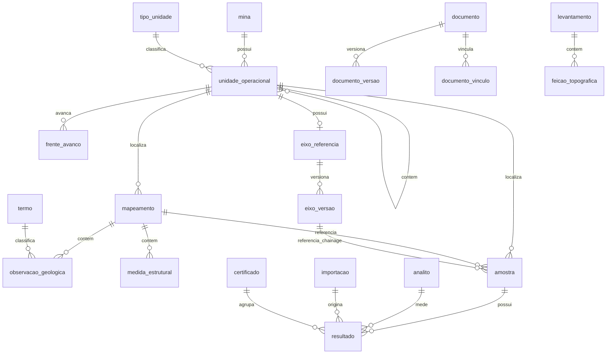

# BANCO DE DADOS — Modelo inicial

> Estado: modelo lógico da Etapa 1, **adaptado ao SQLite em 2026-11-25** (DT-016/DT-017).
> **Tabelas implementadas:** migração `0001_nucleo` (E2): `usuario`, `papel`, `permissao`, `papel_permissao`, `usuario_papel`, `sessao`, `auditoria`, `arquivo`, `parametro_sistema`. Migração `0002_estrutura` (E3): `mina`, `tipo_unidade`, `regra_hierarquia`, `unidade_operacional`, `unidade_nivel`, `frente_avanco`, mais 10 triggers de integridade e os dados iniciais (9 tipos, regras, 4 permissões). Migração `0003_backup` (E4): permissão. Migração `0004_mapeamento` (E5): `dicionario`, `termo`, `termo_sinonimo`, `mapeamento`, `mapeamento_intervalo`, `medida_estrutural`, `mapeamento_amostra`, `mapeamento_revisao`, 37 triggers (termo do dicionário certo por coluna, classe da medida, ficha só editável em rascunho, exclusão só de rascunho nunca submetido, unidade da mesma mina, revisões imutáveis), 11 dicionários iniciais. As demais tabelas ainda são projeto.

## 0. Adaptação ao SQLite (aplicativo local)

| Projeto original (PostgreSQL/PostGIS) | Implementação local (SQLite) |
|---|---|
| `geometry(PointZ/LineStringZ/…, srid)` | `geom` BLOB com WKB 2D/3D + `srid` + `dimensao`; índice R*Tree 3D |
| `ltree` (caminho da árvore) | coluna texto `caminho` materializada (`/id1/id2/…`) mantida pelo serviço, com índice |
| `JSONB` | `JSON` (texto validado; funções `json_*` do SQLite) |
| `citext` (login) | `COLLATE NOCASE` |
| `timestamptz` | `DateTime(timezone=True)` gravado sempre em UTC |
| `uuid` | `Uuid` do SQLAlchemy (32 caracteres hexadecimais) |
| auditoria por trigger com `SET LOCAL` | eventos do ORM + triggers de imutabilidade (DT-019) |
| `spatial_ref_sys` | base EPSG do PROJ (pyproj) |
| `num_nonnulls(...) = 1` | `CHECK ((a IS NOT NULL) + (b IS NOT NULL) + … = 1)` |
| `SELECT … FOR UPDATE` (gerar código) | transação `BEGIN IMMEDIATE` (o SQLite serializa escritas) |

> As tabelas serão criadas progressivamente, por migrações Alembic, na etapa de cada módulo.
> O modelo completo é apresentado agora para garantir que as primeiras tabelas não bloqueiem as seguintes, especialmente as espaciais.

## 1. Convenções

- PostgreSQL 16 + PostGIS 3; extensões `postgis`, `ltree`, `pgcrypto`, `citext`.
- Nomes em português, `snake_case`, singular.
- PK `id uuid` em todas as tabelas de domínio (DT-007).
- Colunas padrão de domínio: `criado_em timestamptz`, `criado_por uuid → usuario`, `atualizado_em`, `atualizado_por`, `versao int` (concorrência otimista), `ativo bool` quando houver inativação.
- Datas/horas em `timestamptz` (UTC no banco, exibição no fuso da mina).
- Geometrias sempre com SRID explícito = `mina.srid_trabalho`; Z em metros.
- Exclusão física proibida para registros com vínculos: `ON DELETE RESTRICT` como padrão; inativação lógica.
- `CHECK` para faixas de valores (mergulho, azimute, chainage ≥ 0 etc.).
- Auditoria por trigger em todas as tabelas de domínio (seção 9).

## 2. Núcleo — usuários e permissões (Etapa 2) **[IMPLEMENTADO]**

| Tabela | Colunas principais | Restrições |
|--------|--------------------|-----------|
| `usuario` | id, nome, email `citext`, login, senha_hash, ativo, ultimo_acesso | UNIQUE(login), UNIQUE(email) |
| `papel` | id, codigo, nome | UNIQUE(codigo) |
| `permissao` | id, codigo (`modulo:acao`), descricao | UNIQUE(codigo) |
| `papel_permissao` | papel_id, permissao_id | PK composta |
| `usuario_papel` | usuario_id, papel_id | PK (usuario, papel). *Restrição por mina adiada até existir mais de uma mina.* |
| `sessao` | id, usuario_id, token_hash, criado_em, expira_em, revogado_em | UNIQUE(token_hash) (DT-018) |
| `parametro_sistema` | chave, valor | ex.: `instalacao_id` |

## 3. Estrutura operacional (Etapa 3) **[IMPLEMENTADO — ver ajustes abaixo]**

| Tabela | Colunas principais | Restrições / observações |
|--------|--------------------|--------------------------|
| `mina` | id, codigo, nome, srid_trabalho, unidade_comprimento ('m'), fuso_horario, origem_local_x/y/z (opcional), observacoes | UNIQUE(codigo); FK srid → `spatial_ref_sys` |
| `tipo_unidade` | id, codigo, nome, icone, cor, possui_eixo bool, multinivel bool, e_frente bool, ordem | UNIQUE(codigo). Ex.: REGIAO, NIVEL, GALERIA, TRAVESSA, RAMPA, SUBDIVISAO, FRENTE, REALCE, CHAMINE |
| `regra_hierarquia` | tipo_pai_id, tipo_filho_id | PK composta — define quais tipos podem conter quais |
| `unidade_operacional` | id, mina_id, tipo_id, pai_id (nulo = raiz da mina), codigo, nome, caminho `ltree`, cota_referencia, status, descricao, ativo | UNIQUE(mina_id, codigo); `pai` da mesma mina (trigger); tipo do pai permitido por `regra_hierarquia` (trigger); `caminho` mantido por trigger; GiST em `caminho` |
| `unidade_nivel` | unidade_id, nivel_id | Para unidades multinível (rampa ↔ níveis). `nivel_id` deve ser do tipo NIVEL |
| `frente_avanco` | id, frente_id, data, chainage, origem_chainage ('manual','calculado'), eixo_versao_id, geom PointZ, avanco_m, responsavel_id, observacao | `frente_id` deve ser unidade com `e_frente` |

**Ajustes na implementação (E3):**
- `mina`: `srid_trabalho` validado (precisa ser um sistema projetado em metros); `declinacao_magnetica` (graus, + leste). Sem `origem_local` (será calculada pelo visualizador 3D).
- `tipo_unidade`: `pode_ser_raiz` e `e_nivel` acrescentados (DT-023).
- `unidade_operacional.caminho`: texto `/hexid/…/` mantido por trigger; `status` ∈ ativa/paralisada/encerrada; `UNIQUE(mina_id, codigo)` sem distinção de maiúsculas.
- `frente_avanco`: `x, y, z` em colunas (DT-024) em vez de `geom`; `referencia` obrigatória quando há distância; `eixo_versao_id` e `origem_chainage` entram na E10.
- Triggers: `trg_unidade_valida_insercao`, `trg_unidade_caminho_insercao`, `trg_unidade_valida_alteracao`, `trg_unidade_caminho_alteracao`, `trg_unidade_nivel_valida`, `trg_avanco_so_em_frente_*`, `trg_tipo_unidade_caracteristicas`, `trg_tipo_unidade_raiz`, `trg_regra_em_uso`.

> **Por que árvore genérica?** Ver ANALISE_CRITICA A1. A hierarquia é configurável, impõe regras pelo banco e permite consultar a sub-árvore inteira com `caminho <@ 'MINA.N350.GAL01'`.

## 4. Dicionários configuráveis (Etapa 5) **[IMPLEMENTADO]**
> Implementação: `termo` ganhou `sigla` e `classe` (planar/linear para estruturas); `termo_sinonimo` (texto normalizado único por dicionário). `definicao_atributo` (campos customizados) adiada.

| Tabela | Colunas | Observações |
|--------|---------|-------------|
| `dicionario` | id, codigo, nome, descricao, sistema bool | Ex.: LITOLOGIA, ALTERACAO, INTENSIDADE, TIPO_ESTRUTURA, MINERAL, ESTILO_MINERALIZACAO, TIPO_ATIVIDADE, TIPO_CONTATO |
| `termo` | id, dicionario_id, codigo, nome, descricao, cor, pai_id (hierarquia de termos, ex.: grupo litológico), ativo, ordem | UNIQUE(dicionario_id, codigo) |
| `definicao_atributo` | id, contexto (ex.: `observacao:ALTERACAO`), codigo, rotulo, tipo (texto/num/inteiro/data/termo/booleano), dicionario_id, obrigatorio, min, max, unidade | Campos customizados (DT-009) |

## 5. Mapeamento geológico (Etapa 5) **[IMPLEMENTADO — ajustes abaixo]**
> Implementação: cabeçalho conforme a ficha (exposição, distância + referência, seção L×A, azimute, XYZ, norte de referência, declinação, água, obs. geotécnicas, número `MAP-AAAA-nnnn`); intervalos em `mapeamento_intervalo` (de/até ao longo da seção); medidas em `medida_estrutural` com `valor_digitado`/`convencao`; amostras citadas em `mapeamento_amostra` (código canônico; ligação ao cadastro de amostras na E8); `mapeamento_revisao` guarda o instantâneo aprovado ao reabrir. Posição ao longo do eixo (chainage) e geometria entram na E10.

| Tabela | Colunas principais | Restrições |
|--------|--------------------|-----------|
| `mapeamento` | id, mina_id, unidade_id, data, geologo_id, tipo_atividade_termo_id, chainage_de, chainage_ate, origem_chainage, eixo_versao_id, geom PointZ, referencia_espacial (texto), descricao, observacoes, estado (`rascunho`/`submetido`/`aprovado`/`cancelado`), revisao int | estado aprovado → edição gera nova revisão |
| `mapeamento_revisao` | id, mapeamento_id, revisao, conteudo JSONB (instantâneo completo), revisado_por, revisado_em, motivo | UNIQUE(mapeamento_id, revisao) |
| `observacao_geologica` | id, mapeamento_id, categoria (`litologia`/`contato`/`alteracao`/`mineralizacao`/`mineralogia`/`outra`), termo_id, intensidade_termo_id, posicao_de, posicao_ate, posicao_referencia (`chainage`/`face_esquerda`/`face_direita`/`teto`/`frente`), percentual, descricao, atributos JSONB | termo deve pertencer ao dicionário da categoria |
| `medida_estrutural` | id, mapeamento_id, tipo_termo_id, classe (`planar`/`linear`), dip_dir, dip, trend, plunge, valor_digitado JSONB, convencao_entrada, norte_referencia (`magnetico`/`quadricula`/`verdadeiro`), declinacao_aplicada, plano_hospedeiro_id, geom PointZ, descricao | CHECK dip ∈ [0,90], dip_dir/trend ∈ [0,360), plunge ∈ [0,90]; planar exige dip_dir+dip; linear exige trend+plunge |

## 6. Arquivos, croquis, fotos, documentos (Etapas 6–7) **[IMPLEMENTADO — migração 0005]**
> Implementação: `documento` (inclui campos de foto: legenda, identificador, exif, x/y/z; `origem_id`/`origem_pagina` para páginas separadas de PDF; `arquivado`), `documento_versao` (imutável por trigger; páginas, largura/altura), `documento_vinculo` (unidade **ou** ficha; amostra entra na E8). `foto` não virou tabela separada: é a categoria `foto`. Derivados (miniaturas, prévias) ficam em `arquivos/derivados`, fora do banco.

| Tabela | Colunas principais | Observações |
|--------|--------------------|-------------|
| `arquivo` **[IMPLEMENTADO]** | id, sha256, tamanho, mime, nome_original, chave, enviado_por, enviado_em | UNIQUE(sha256) — conteúdo deduplicado |
| `documento` | id, mina_id, categoria (`croqui`/`foto`/`relatorio`/`planilha`/`gis`/`topografia`/`campo`/`outro`), titulo, descricao, data_documento, autor_id, estado | entidade lógica com versões |
| `documento_versao` | id, documento_id, numero, arquivo_id, nome_original, motivo, criado_por, criado_em | UNIQUE(documento_id, numero); nunca apagada |
| `foto` | documento_id (PK/FK), legenda, identificador, data_captura, exif JSONB, geom PointZ, orientacao | especialização de documento |
| `documento_vinculo` | id, documento_id, unidade_id, mapeamento_id, amostra_id, medida_id, levantamento_id, observacao | **CHECK num_nonnulls(unidade_id, mapeamento_id, amostra_id, medida_id, levantamento_id) = 1** — FKs reais, sem vínculo polimórfico sem integridade |
| `derivado_arquivo` | arquivo_id, tipo (`miniatura`/`previa`), chave_armazenamento | regenerável |
| `sugestao_extraida` *(futuro)* | id, documento_versao_id, tipo, conteudo, confianca, estado (`nao_validada`/`aceita`/`rejeitada`), revisado_por | OCR/IA (RF-DOC-08) |

## 7. Amostragem e geoquímica (Etapas 8–9) — **amostragem IMPLEMENTADA (migração 0006)**
> Implementado: `tipo_amostra`, `campanha`, `amostra` (com `serie`, `srid` das coordenadas, `local_descricao`, `ponto_campo`, seção/profundidade, `importacao_id` + `linha_origem`), `lote_envio`, `lote_envio_amostra`, `importacao` (genérica: amostras/resultados/topografia). `regra_codigo_amostra` configurável e `padrao_referencia` adiados (regras BS-RP/BMT-TS/BE fixas; CRM pelo código). Triggers: termos do dicionário certo, mesma mina, lote enviado fechado.
> **Geoquímica IMPLEMENTADA (migração 0007):** `laboratorio`, `metodo_analitico` (por laboratório), `analito` (código sensível a maiúsculas, tipo elemento/óxido/parâmetro), `certificado` (único por laboratório; ligado à importação), `resultado` (valor_texto, valor_num, qualificador `= < > NA --`, limite, unidade, tipo_linha SMP/DUP/REP/STD/BLK, `codigo_laboratorio` e `codigo_canonico`, `amostra_id` opcional, `preferido`, linha de origem). Triggers: resultado imutável e não excluível; vínculo só com amostra da mesma mina. `unidade_medida` com conversões e `padrao_valor_certificado` adiados.

| Tabela | Colunas principais | Restrições |
|--------|--------------------|-----------|
| `tipo_amostra` | id, codigo, nome, geometria_esperada (`ponto`/`intervalo`/`ambos`) | — |
| `metodo_amostragem` | id, codigo, nome | — |
| `regra_codigo_amostra` | id, mina_id, nome, padrao_regex, prefixo, proximo_numero, digitos, ativo | geração atômica (`SELECT … FOR UPDATE`) |
| `campanha` | id, mina_id, codigo, nome, inicio, fim, objetivo | UNIQUE(mina_id, codigo) |
| `amostra` | id, mina_id, codigo, unidade_id, campanha_id, data_coleta, geologo_id, tipo_id, metodo_id, papel_controle (`normal`/`padrao`/`branco`/`dup_campo`/`dup_preparacao`/`dup_pulpa`), amostra_original_id, padrao_id, geom (PointZ ou LineStringZ), chainage_de, chainage_ate, origem_chainage, eixo_versao_id, afastamento_eixo_m, litologia_termo_id, alteracao_termo_id, mineralizacao_termo_id, estrutura_termo_id, mapeamento_id, massa_kg, descricao, observacoes, estado | UNIQUE(mina_id, codigo); duplicata exige amostra_original_id; padrão exige padrao_id; GiST(geom) |
| `padrao_referencia` | id, codigo, fornecedor, descricao | CRM |
| `padrao_valor_certificado` | padrao_id, analito_id, valor, desvio_padrao, unidade | — |
| `lote_envio` | id, mina_id, codigo, laboratorio_id, data_envio, responsavel_id, estado | — |
| `lote_envio_amostra` | lote_id, amostra_id | uma amostra pode ir em mais de um lote (reanálise) |
| `laboratorio` | id, codigo, nome | — |
| `metodo_analitico` | id, laboratorio_id (opcional), codigo, nome, tecnica (FRX, ICP-OES, AAS…), descricao | — |
| `unidade_medida` | codigo (`ppm`, `ppb`, `pct`, `g_t`…), fator_para_ppm | conversões explícitas |
| `analito` | id, codigo (`Cr`, `MgO`, `Fe2O3`…), nome, tipo (`elemento`/`oxido`/`mineral`/`parametro`), unidade_padrao | UNIQUE(codigo) — cadastro aberto |
| `importacao` | id, mina_id, tipo (`resultado`/`amostra`/`topografia`), documento_versao_id (arquivo original), mapeamento_colunas JSONB, relatorio_validacao JSONB, estado (`analisada`/`confirmada`/`cancelada`), importado_por, confirmado_em | arquivo original sempre vinculado |
| `certificado` | id, importacao_id, laboratorio_id, codigo (bateria/lote do laboratório), data_emissao | — |
| `resultado` | id, amostra_id, analito_id, metodo_id, certificado_id, importacao_id, valor_texto, valor_num, qualificador (`=`/`<`/`>`/`ND`/`IS`), limite_deteccao, unidade, data_analise, preferido bool, linha_origem int, ativo | UNIQUE parcial (amostra, analito, metodo, certificado) WHERE ativo; índice (analito_id, amostra_id); índice único parcial `preferido` por (amostra, analito) |

## 8. Espacial e topografia (Etapa 10) **[IMPLEMENTADO — migração 0008]**

| Tabela | Colunas principais | Observações |
|--------|--------------------|-------------|
| `transformacao_coordenadas` | mina_id, nome, srid_origem, srid_destino, metodo (`proj`/`translacao`), parametros JSON {dx, dy, dz}, residuo_medio_m, residuo_max_m, pontos_calibracao, origem_calibracao (arquivo + sha256), aprovada, aprovada_por/em | trigger: uso exige aprovação |
| `levantamento` | mina_id, codigo (único por mina), descricao, data_levantamento, responsavel, importacao_id, camada (arquivo .shp), tipo_geometria, srid_original, transformacao_id, feicoes, vertices, extensão (min/max X, Y, Z), arquivado | levantamentos coexistem |
| `feicao_topografica` | levantamento_id, indice_origem, tipo, dimensao, geom (WKB, sistema da mina), geom_original (WKB, só se convertida), camada_cad, entidade_cad, z_suspeito, atributos JSON, caixa | **imutável e sem exclusão** (triggers); não auditada linha a linha (rastreio pela importação) |
| `feicao_rtree` | R*Tree (id = rowid da feição, min/max X, Y, Z) | preenchida por trigger; consultas por janela |
| `eixo_versao` | unidade_id, numero, geom LineStringZ (WKB), vertices, comprimento_3d, comprimento_2d, origem (`pontos`/`feicao`), feicao_id, inicio_descricao, observacao, vigente | imutável (só `vigente` muda); trigger: tipo da unidade precisa ter `possui_eixo` |
| `posicao_eixo` | eixo_versao_id + exatamente um de amostra_id / mapeamento_id / avanco_id, chainage_m, afastamento_m, ambigua, alternativa_m, transformacao_id | recalculada sob pedido; ligada à versão do eixo |

Diferença da proposta: SQLite em vez de PostGIS (DT-016) — geometria em WKB + R*Tree; o eixo é a própria `eixo_versao` por unidade (sem tabela `eixo_referencia`); a posição no eixo fica em `posicao_eixo` (em vez de colunas nas tabelas de amostra/ficha/avanço), o que permite várias versões do eixo sem alterar os registros de origem.

## 8b. Geoquímica operacional (migração 0009) **[IMPLEMENTADO]**
| Tabela | Colunas principais | Observações |
|---|---|---|
| `layout_analise` | mina_id, dono_id, nome, tipo (`galeria`/`sondagem`/`comparacao`), config JSON (tracks, analitos), compartilhado | único por (mina, dono, tipo, nome); auditado |

## 9. Auditoria (Etapa 2) **[IMPLEMENTADO — por ORM, DT-019]**

| Tabela | Colunas |
|--------|---------|
| `auditoria` | id bigserial, tabela, registro_id, operacao (`I`/`U`/`D`), antes JSONB, depois JSONB, usuario_id, ocorrido_em, transacao_id, origem (`api`/`importacao`/`direto`) |

- Trigger genérico `fn_auditoria()` em todas as tabelas de domínio.
- Particionamento por mês quando o volume justificar.
- Sem permissão de UPDATE/DELETE para o papel de banco da aplicação nessa tabela.

## 10. Diagrama de relacionamentos (núcleo)

## 11. Pontos em aberto do modelo

- Confirmar se haverá **mais de uma mina** no mesmo sistema (o modelo já suporta).
- Confirmar regras reais de código de amostra e de unidade.
- CRS confirmados: SIRGAS 2000 / UTM 23S (31983) e SAD69 / UTM 23S (29193). Proposta: CRS de trabalho = SIRGAS 2000 (a confirmar).
- `amostra.codigo`: regras BS-RP (mina), BMT-TS (testemunho), BE (antigas); forma canônica sem espaços (DADOS_REAIS.md §3).
- `termo`: acrescentar tabela `termo_sinonimo` (grafias encontradas na importação → termo).
- `resultado`: acrescentar `tipo_linha_laboratorio` (SMP/DUP/REP/STD) dos laudos SGS.
- Topografia: `feicao_topografica` ganha `camada_cad`, `entidade_cad`, `cor_cad`, `z_suspeito`.
